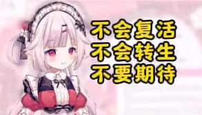
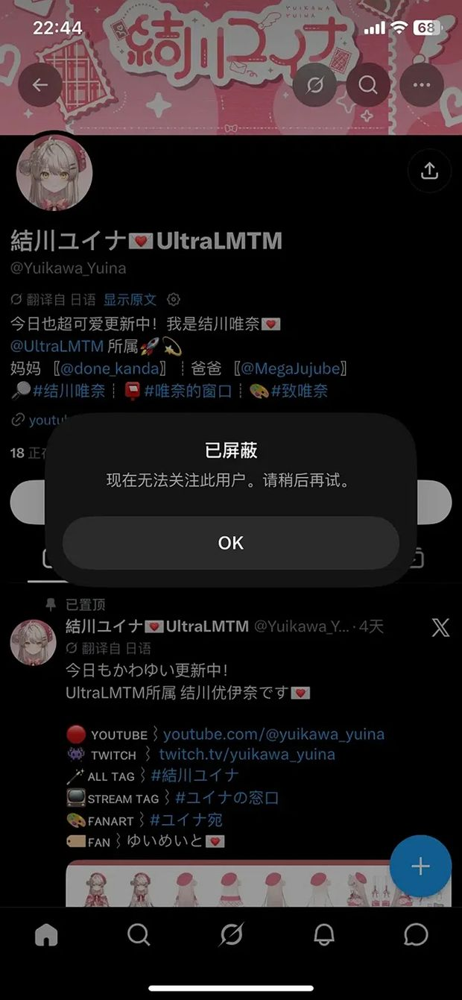
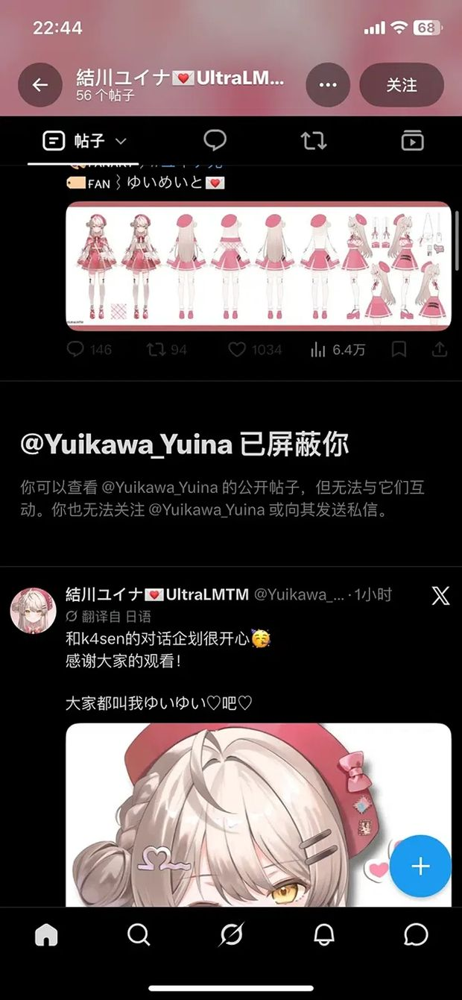
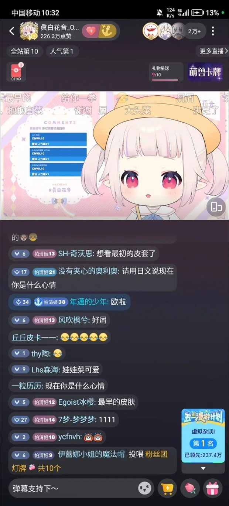

# 当承诺被做成了葬礼：一次虚拟主播「转生」事件里的信任、话术与共同体创伤

> 本文只做事实梳理与现象分析，不站队、不判决。对当事人不做道德评价。
> 事件仍在发展中（截至 2026 年 10 月 11 日），部分关键信息只有单一来源，文中会逐条标注性质。
> 涉及多方商业纠纷的内容，本文只转述公开报道中的**说法**，并明确标注其为单方面指称，不作事实认定。

※

本文持续更新中

这件事从 10 月 5 日首配信到现在仍在快速变化——当事人的立场、平台的处理方式、行业内部的说法，都会陆续出现新版本。本文会随时补充与订正，并把「已证实」与「只有单一来源」的内容分开标注（见第七节）。 最后更新：2026-10-11

<strong>更新记录</strong> 2026-10-11　补充「首播屏蔽中文发言」「X 账号拉黑」两条实证；订正此前对两张截图的误读；新增 UltraLMTM 招募时间线与公会方说法一节；可信度分层表扩充 2026-10-08　初版发布

## 一、一条被广泛证实的消息

2026 年 10 月 7 日，中文互联网开始流传一个说法：B 站头部日V 虚拟主播**真白花音**（粉丝名「帕清姬」，216 万粉）在宣布「永久毕业」五个月后，以新身份重新开始活动。

新身份是**結川ユイナ**（Yuikawa Yuina），2026 年 10 月 5 日 19:00（日本时间）在 YouTube 完成初配信，隶属 VTuber 品牌 **UltraLMTM**——由 GANYMEDE（ZETA DIVISION 母公司）运营、k4sen 担任制作人。

事件的争议点，用三句话就能概括：

1. 2026 年 4 月 30 日，她在毕业直播里以一张毕业证书的形式，向两万名观众告别；
2. 5 月 1 日起，真白花音账号「永久停止全部活动」；
3. 158 天后，同一个声音出现在另一个平台的另一个账号里。

而**接下来四天发生的事，把这场争议的性质整个改变了**——这才是本文真正要处理的东西。

## 二、时间线：一个被漏掉的关键日期

图 1：社区里流传最广的那张图。左边是新身份形象，右边是三句话。矛盾感之所以这么强，是因为这两样东西被放在一起看了。

把关键节点按时间排开：

- **2019-05-01** 真白花音出道，隶属个人势企划「ちゅこらら」
- **2019-10-24** 在推特宣告将于月末引退
- **2020-12-01** 宣告「复活」，随后加入 P 家
- **2026-01-24** 举办五周年纪念 3D 演唱会，此时仍在正常活动
- **2026-04-17** 宣布因身体与心理问题、医嘱要求长期休养，将于 5 月 1 日起永久停止活动
- **2026-04-30** 毕业直播，2 万观众在场，最后展示毕业证书，达成「千人舰队」成就
- **2026-05-02** 将早期自我介绍、回归声明、部分 vlog 与直播回放设为「仅自己可见」
- **2026-09-28** UltraLMTM 公开一期生名单，結川ユイナ在列
- **2026-10-05** 結川ユイナ初配信
- **2026-10-07** 社区扒出身份。国内媒体开始集中跟进
- **2026-10-08** 第二次直播，**开始大规模屏蔽中文发言**
- **2026-10-09** 切片账号「绯吧official」开直播澄清
- **2026-10-10** 国内媒体报道中演变为三方混战

### 那个被漏掉的日期

很多人注意到「毕业才五个月就转生」，但很少有人去查一件事：**結川ユイナ 所在的这个企划，本身是什么时候开始招募的？**

UltraLMTM 这个品牌在 **2025 年 9 月 27 日**的东京电展（TGS 2025）上首次公布，同日同时**开启第一期生招募**。招募窗口是 2025 年 9 月 27 日至 10 月 31 日。

这个日期距她宣布毕业（2026 年 4 月 17 日）有**近七个月**，距毕业直播（4 月 30 日）有**六个月**。

这条时间线的意义在于：它把社区里流传的「2025 年 10 月就开始找下家、2026 年 1 月面试通过」这类说法，从「网传截图」升级成了**可以在品牌官网和媒体报道里核对的时间戳**。

需要谨慎的是：招募窗口开放不等于报名者一定是她，也不等于她在窗口期就通过了。但它至少排除了「临时起意」这个可能性——如果她是 2026 年 4 月之后才想到要转生，就不需要去参加一个半年前已经结束的招募。

**这一条是全篇唯一一个双方都无法否认的硬证据。**

关键点还在于：**这不是她人生中第一次「转生」。** 2019 年宣布引退、2020 年复活，是同一个账号上的同一次转生。所以「VTuber 转生」这件事在这个圈子里，本身是有先例、有共识基础的。

真正没有先例的部分，是**告别的规格**。

## 三、「不会转生」这句话是谁说的

社区里流传最广的控诉是那著名的「三不」——**不会复活、不会转生、不要期待**。

但这里必须做一次拆分。

根据可查到的公告原文，措辞是这样的：

> 因此决定自 2026 年 5 月 1 日起，**永久停止【真白花音】账号的全部活动**。

请注意这句话的边界：它限定的是「【真白花音】账号」，不是「这个人不再从事 VT 活动」。而在 B 站的评论区内，有相当一部分老粉在毕业时就已经在纠正这一点——他们说，那句「不会转生」多半来自切片账号的标题与运营话术，**并不是她本人的原话**。

但这个说法现在也需要修正。后续的多篇报道里提到，她在毕业直播当晚**明确否认了未来复活的可能**。也就是说：

- 公告文本层面，她承诺的是「停止这个账号」
- 直播口头层面，她把话说到了「不会回来」

这两个层级不一致。而听众记住的通常是后者。

所以在事实层面能确定的是：

- 她本人确实表达过「不会复活」的意向，**这一点已经不再只是切片话术**
- 但她**从未在文本上承诺「永不以任何身份复出」**
- 这个空白，后来被整个社区用最严格的读法填满了

而**这仍然不减轻伤害**——因为伤害主要不来自这句话本身。

## 四、真正的转折：首播的「装失忆」

如果这件事只到「转生」为止，它仍然是一场关于承诺的讨论。

**10 月 5 日首播开始，性质就变了。**

据多方报道与直播切片：

- 首播直播间同时在线上千人，其中中国 IP 占相当比例，弹幕被中文刷屏
- 面对满屏中文，这位「新人 VTuber」表示自己看不懂汉字、不会读中文
- 有观众发现，她念某些字时似乎下意识读出了中文发音
- 随着中文弹幕增多，她逐渐只回应少数日语弹幕
- 到直播后段，**中文评论被屏蔽**

到了 **10 月 8 日的第二次直播**，处理方式进一步升级：**只要发任何一句中文，房管立刻封禁，包括付费赠送的 SC 也一样**。

但要说清楚的是：**屏蔽并不只发生在直播间里，也不只发生在 YouTube 上。**

下面这两张截图是 **X（推特）** 的界面，不是直播画面：

图 2：X 时间线从被屏蔽者一侧看到的提示：「已屏蔽你——你可以查看公开帖子，但无法与它们互动，也无法关注或发送私信。」

图 3：同一动作在 X 主页视角下的样子。通往新身份的一切入口，都在这里被关闭。

也就是说，**中文用户在一句中文回复之后，拿到的是两个平台上的同一套处理**：

| 平台 | 处理方式 | 性质 |
|---|---|---|
| YouTube 直播间 | 房管封禁中文发言（含付费 SC） | 房间层面的秩序管理 |
| X（推特） | 账号拉黑，无法互动 / 关注 / 私信 | **账号所有者层面的关系拒绝** |

两张截图里这种差别值得细看：

- 直播间封禁，通常还能换个方式说上话——它更像是「房管在维持秩序」，责任可以被推给规则
- 而 X 上的拉黑是**账号本人（或代运营者）点下去的动作**：它明确表示「我不想再和你有任何交互」

这也是为什么很多人收到的不是愤怒，而是那种说不上来的错愕——

因为对中文观众来说，他们想说的话其实只有一句：**「你是不是白菜？」**

账号给出的回答是：「你不能问。」

社区里那句被反复引用的话，在这里获得了它的完整含义：**「怎么，帕清姬，面对这梦寐以求的重逢，连话都说不出来了？」**

另外，主页上还有一个细节值得记录：置顶帖把所有对外标签都配齐了——全 TAG、STREAM TAG、FANART TAG，以及一个**全新的粉丝名**；简介里还标注了角色的画师与建模师（「妈妈」「爸爸」两处署名）。

这是一套**完整、独立、从零开始的新身份**。它必须准备新的粉丝名，因为旧的粉丝名不能再用了。

社区的调侃是：「中文语音包是卸载了，但好像没卸载干净，还留着点残余。」

图 4：社区流传的玩梗图。这类图能传开，本身就说明「被割」这个叙事已经成了默认前提。

### 这里必须做一次公正的拆分

关于这件事，社区里有两种说法，而且两种都有各自的道理。

**第一种：新角色不认识中文是正常角色演出。**

結川ユイナ是一个全新的虚拟角色，有全新的人设。在企划设定的框架里，「这位魔法使见习生不识字」是完全合理的角色行为。原企划同期出道的另外五位一期生，全都是各自全新的角色。

从纯运营角度看，**切割身份、避免老粉绑架新企划，是 VTuber 行业的标准操作**。大量头部主播转生时都会刻意淡化与前身的关联，这一点上她并没有做什么特别反常的事。

所以真正的问题从来不是「新人设不认识中文」——那是行业惯例，无可指摘。

真正的问题是：**一个需要全新粉丝名的账号，面对的却是一群带着旧粉丝牌的人。** 这两拨人被迫在同一个直播间里相遇，而运营给出的处理方式，是封掉其中一方。

**第二种：但屏蔽付费中文发言，无法用角色设定解释。**

这是关键的分界线。

- 「不识字」是角色设定，可以辩护
- 「不回应中文提问」是可以理解的角色行为
- **但「封禁一切中文发言，包括花了钱的」不是角色行为，这是运营行为**

角色可以在设定里失忆。**运营不能在设定里屏蔽付费用户。**

而这一步有一个特别刺眼的细节：真白花音在 B 站时期的商业模式，核心就是「对着中文弹幕学中文」这件事本身。她是靠这个内容品类积累起 216 万粉丝的，而这些观众是**订阅者、舰长、付费用户**。

也就是说，新账号正在执行一套**与它在中文市场的全部商业基础直接冲突**的运营策略。

而这恰恰也是评论区里粉丝情绪最激烈的原因之一：**这些人既是「背叛者」，也是「被背叛者」。** 他们既是来质问的，也是来支持消费的。

这批截图里最容易被忽略的一张——**它不是转生之后拍的。**

图 5：毕业那阵子的直播画面。右上角在线 2 万+，弹幕区几乎被带「帕清姬」粉丝牌的用户占满。

这张图里的每一个元素，都在为「为什么后来那一下会这么疼」提供注脚：

- 右上角是 **2 万以上的实时在线**
- 弹幕发送者几乎都带着「帕清姬」粉丝牌（牌级从 1 级到 38 级不等）
- 弹幕内容几乎全是中文：**「想看最初的皮套了」「最早的皮肤」「请用日文说现在你是什么心情」「娃娃菜可爱」**
- 右下角还挂着「虚拟杂谈 · 第 1 名」的栏目标签

请注意这些弹幕在说什么。**他们要的是「最初的皮套」「最早的皮肤」——在告别的时候，他们想再看一眼最开始的样子。**

这是一期一会式告别里最典型的情感：我要记住你最初的模样。

而五个月后，同一批带着粉丝牌、打字习惯一模一样的人，出现在新的直播间里。

**他们收到的回复是：屏蔽。**

这才是整件事真正的时间结构——**不是「她转生了」，而是「那间直播间里的 2 万人，后来被逐出了这个名字的继承关系」。**

那张毕业证书上写的是「见证人：全体帕清姬」。

现在是 10 月。

## 五、被忽略的第三方：切片生态的位置

事件发酵过程中，社区里出现了一句被转发了很多次的话，大意是：**「现在最可怜的人就是绯吧。」**

绯吧（「绯吧official」）是中文互联网上最大的真白花音切片账号之一。萌娘百科词条里有一条记载得很直接：由于在制作切片时大量使用「日本萝莉」这一关键词，账号在短时间内获得了巨大的流量，随后其他切片账号纷纷效仿——真白花音也因此成为 B 站约定俗成的「日本萝莉」这个标签的代表。

这意味着一个结构性的事实：

> **真白花音 216 万粉丝里，有相当大一部分是切片喂养出来的。这批人关注的是「日本萝莉」这个内容品类，而不是这个具体的人。**

### 争议升级后，绯吧发生了什么

10 月 9 日晚，绯吧official 开直播回应。整场两个多小时，**唯一涉及钱的回应是展示了这个账号六年来做切片获得的收益——七千多元**。

而几项被粉丝关心的问题，直播里没有回应：这六年和白菜的关系如何演变、毕业与转生的事是否知情、自己与这位主播是否有过直接联系。

顺带一提，这个回应方式本身也引发了大量不满。有评论追问：「原来绯吧连白菜的联系都没有吗？」——这确认了一件此前只是猜测的事：**这个号为真白花音贡献了大量流量的人，与她之间没有私人联系方式。**

（说明：网上流传的「大学时期开始自费做切片、月生活费 1800 元、六年没接过商单、切片播放超过一亿」等具体数字，均出自网友爆料，**没有可核实的公开材料**，本文只作为「传闻存在过」记录，不作为事实引用。）

### 这才是那句「最可怜」的实质

在舆论结构上，绯吧是**唯一一个在这次事件里既没有做错任何事、也没有任何立场的人**。

- 他没有违约
- 他没有消费谁的信任
- 他没有拿过一分钱不属于他的钱——六年，七千多
- 他只是把自己全部的时间押注在了一个人格上

而那个人格单方面宣布终止了关系。他甚至**没有渠道提前知道**。

> 如果说社区对「转生」这件事本身有分歧，那么「最可怜」这个说法的一致性要高得多。因为**利益受损最直接、且从头到尾没有话语权的人，只有一个。**

## 六、舆论结构的突变：从两个人的事，变成三方混战

10 月 7 日晚，一个意外的角色入场了。

**乐府**——国内一家虚拟主播公会的负责人——开启直播，公开谈论真白花音的毕业与转生。随后几天，国内媒体对其说法做了长篇整理转载。

需要非常明确地说明的是：**这些内容全部是乐府一方的单方面说辞，转述方自己在文首就标注了这一点。** 它们包括（且仅包括对方公开说过的内容）：

- 真白花音 2025 年 9 月因收益断流主动联系公会商讨转生去向
- 2026 年 1 月锁定退场排期与新签约机构，比公开宣布早三到四个月
- 毕业直播单场流水约 60 万元，「若非利用绝版情绪刺激打赏，常规收益至少缩水一半」
- 期间存在与字幕组的谈判破裂、合同乌龙等纠纷
- 最终日本合作方收回了「真白花音」的形象 IP

**关于「字幕组私吞收益」的部分，属于未经独立核实的商业指控。本文不将其作为事实陈述，也不作任何判断。**

但即便把以上全部当作待验证的声称，有一件事仍然值得注意——**这类内容的存在本身，改变了这事件的舆论力学**。

原本的舆论结构很简单：**粉丝 vs 主播**。情感明确，道德清晰。

当一个掌握行业内幕的第三方入场，并且它的说法与粉丝的愤怒**部分吻合**（都指向「存在隐瞒」），但**利益位置完全不同**时，事情就变了：

粉丝的愤怒是**被背叛感**——我要的是一个交代
乐府的愤怒是**被背刺感**——我垫了资源，人却走了

这两种愤怒可以互相印证，但不能互相替代。

而当一个更有行业话语权的人开始提供「内幕」时，社区里出现了一个很典型的现象：**一部分人开始转向攻击这个第三方，而不是继续追问当事人。**

这在舆论研究里叫议题漂移。它有一个很实际的后果——**追责的焦点从「谁欠我一个解释」变成了「谁最可恶」，而后者永远无法结案。**

客观说一句对各方都成立的话：**在这件事里没有任何一方是干净的。** 主播有表达上的算计，公会与字幕组之间有长期积累的纠纷，转生本身是她的自由。

如果一定要排个优先级：**被损害最深、且从头到尾没有发言权的那个群体，排在所有互相指责的群体之前。**

## 七、信息可信度分层

这类事件里最容易出问题的地方，就是把「合理推测」当「已确认事实」传播。目前流通的说法，性质如下：

|说法 | 传播广度 | 可信度 |
|---|---|---|
| 毕业时间、毕业直播、删除视频 | 极高 | 有公告与实际页面为证 |
| 新账号与初配信时间 | 极高 | 频道与推特均可查 |
| 首播/二次直播屏蔽中文 | 极高 | 多家媒体与切片一致 |
| X 上拉黑中文用户 | 高 | **截图实证**（时间线 + 主页双重提示） |
| **UltraLMTM 招募期 2025-09-27 起** | 中 | **可公开核对**（品牌官网与媒体报道） |
| 「三不」仅为切片话术 | 中 | **已被部分推翻**，直播中确有口头表态 |
| 60 万流水、2025-09 接触下家 | 中 | 单一来源（公会方直播） |
| 日方收回形象 IP | 中 | 单一来源（公会方直播） |
| 字幕组私吞收益 | 中 | **未经核实的商业指控** |
| 切片人六年收入 1800/月等 | 中 | 网友爆料，无可核实材料 |
| 各种对个人动机的归因 | 极高 | 纯推测 |

需要特别说明的，是**乐府的说法为什么值得单独列一行**。

它既不是空穴来风——大量细节具体到月份、金额、机构名，可查证性远高于普通爆料；也**不能当作事实使用**——因为来源是**利益相关方本人**，且他在这个事件里同样有立场。

一个更稳妥的读法是：**把这些内容当作「存在这条线索」来记录，而不是「这条线已经成立」。**

顺带说一句：目前中文社区里传播最广的「公会欠薪」类说法，全部是匿名爆料，没有实锤材料。在没有可靠信源之前，把它当作解释框架使用，等于是在给一个未验证的因果链加固。

## 八、VTuber 的「转生」为什么本不该是新闻

把视角拉远一点，这件事处在一个非常成熟的行业惯例里。

在虚拟主播生态中，**角色与中之人是分离的**。角色是一个 IP，可以有名字、有生日、有性格、有形象设定；中之人是一个真实的人，负责表演与运营。围绕这套结构，行业里形成了几条被广泛接受的惯例：

- **毕业**（引退）：停止这个账号的活动
- **转生**：换一个账号重新开始，用新的角色身份
- **毕业不等于退圈**，只等于「这个角色不再活动」
- 只要不同时使用两个身份运营同一份粉丝关系，转生是**合规且常见**的

真白花音自己 2020 年就做过一次。所以从行业逻辑上说，她这次的操作完全在规则之内。

社区里有一条被反复引用的评论，我觉得是整件事里最清醒的一句话：

> 现在的虚拟主播，感觉快像是方便逃避责任的工具和幌子了。

这句话里藏着一个真实的行业矛盾：**规则允许转生，但观众的心理契约不允许。** 平台和公司按「账号」计算，情感按「人」计算，两边的口径从来就没对齐过。

也就是说，争议的真实结构不是「她该不该转生」，而是：

> **当「角色可以被回收」成为行业惯例，而「人」被当成角色的一部分来承诺时，谁来为这个口径差买单？**

## 九、几种立场，逐一拆开

**第一种：支持转生，认为这很正常。**
论据是行业惯例 + 她的账号所有权 + 旧公告措辞本来就限定了账号 + 她的身体状况可能是真的。这个立场最稳，但它有一个盲区：它把「她有权这么做」和「这件事没有伤害任何人」当成了同一件事。

**第二种：认为构成背信。**
论据是三句话式的告别强度、删视频的行为、以及「赛博葬礼」的仪式感。这个立场情绪上最能被理解，但它的强度依赖一个前提：她知道自己在做什么。

**第三种：认为「没做错什么」。**
论据是打赏是自愿的、关注是自愿的、虚拟内容本来就是演出。这条立场在法律和逻辑上都很稳，但它低估了一件事：观众投入的不只是钱，还有**时间与情感**。把这两者都算作「自愿」来完成道德清算，本身也是一种粗暴。

**第四种：把火力对准切片账号。**
切片账号的「日本萝莉」标签确实带流量，但那是内容策略，不是欺诈。

**第五种：把火力对准公会和字幕组。**
这一派认为行业内部早有积怨，主播是被更黑的手推着走的。这个视角能解释一部分问题——**它确实能解释为什么转生会这么快**——但它同时也是最容易被利用的一种叙事，因为施害者的形象一旦被塑造出来，追问的成本就消失了。

**第六种，也是我认为最接近问题核心的：把「被背叛感」当作主要情绪来处理。**

下面单独展开。

## 十、我们真正在愤怒什么

如果把评论区里上千条发言做一次归纳，会发现愤怒的对象很少是「转生」这个行为本身。

排在前面的表述，几乎都在说同一件事：**信息不对称。**

一位观众的追问写得最完整：

> 他们的生气点不在于她转不转生，在于停播之前疯狂地渲染——不转生、不复活、不要期待。然后这个时候回头你告诉我说这是文字游戏。她又没说不在外网转生。而且最后直播的那三天疯狂渲染氛围，那三天的应收快顶上大半年了。

这段话里有三个层次的委屈：

1. **被剥夺了知情权**：作为观众，你被引导相信了一个结论，而结论的制定者持有一个不同的结论
2. **被当成资源**：那三天的告别本身就是一场高密度的打赏收割，而「永久」这个措辞为它提供了道德正当性
3. **被剥夺了哀悼权**：即使粉丝提前知道，她也可以正常告别。问题不在于她要走，而在于她要你以为自己再也见不到她

第 3 点是很多人忽略的。**真正的伤害不是「她回来了」，而是「你被迫经历了一次没有告别的告别」。**

这在心理学上有对应的机制。心理学里管这种「被剥夺预期」的现象叫做**预期违背**，而它的伤害强度和违背幅度、以及「违背者是否知情」高度相关。

而 10 月 8 日屏蔽中文发言这一步，把这件事的性质又推了一层：

- **转生**伤害的是「过去的粉丝」
- **屏蔽中文**伤害的是「现在的付费用户」

两拨人原本可以互相理解——老粉知道她换了身份，新用户不认识她，各取所需。但屏蔽付费中文发言这一下，把两个群体强行推到了对立面：

- 老粉觉得被切割
- 中文用户觉得自己是被拒之门外的消费者

**这是整个事件里唯一一个「怎么做都可以说是错的」位置。** 而这类位置，往往才是真正引爆的地方。

至于社区里那句「她明明可以说展开新的人生冒险，大家都懂什么意思，但就是要骗你生病了」——它的尖锐之处也在这里。**在「把话说死」和「坦白」之间，她选了前者。** 而这个选择的收益是可计算的。

## 十一、结语：三个层次的问题

如果要给整件事留一句结论，那大概是：**这不是一次撒谎，这是一次精确的、没有恶意的、但收益明确的表达选择。**

它的措辞在逻辑上无懈可击，它的转生在行业规则内成立，它的身体状况也无从证伪。

但它同时也是一个懂得「告别规格会决定观众情绪状态」的人。**它用规格当了工具。**

而真正把这套工具砸碎的，是后来的运营动作。角色可以失忆，运营不能屏蔽付费用户——**这条线一旦越过去，前面那些「角色行为」的辩护就全部失效了。**

对粉丝来说，这不构成愤怒的理由，也不构成原谅的理由。它只构成一件很具体的事：**下次再有人告诉你「我永远不会离开这个行业」的时候，你可以选择先打个问号。**

这不是针对某个人。这是这件事真正想教给所有人的东西。

---

最后说一件被彻底忽略的事。

有粉丝在真白花音宣布毕业时自发搭了一个纪念网站。按原计划，这个网站将在 **10 月 14 日关闭**，目前只剩一个分站在运营。

而在舆论最沸腾的这些天里，没有人在意它。

那位为真白花音贡献了大量流量、六年只拿到七千多元、与她连联系方式都没有的切片账号运营者——他在 10 月 9 日开了直播，观众在讨论他的收入数字有没有夸大。

在所有人都忙着找「谁欠谁一个交代」的时候，那个被彻底拿走的形象、那个被做成标本的记忆、那个已经关掉倒计时的纪念网站——

没有人问一句：**它到底是谁的？**
