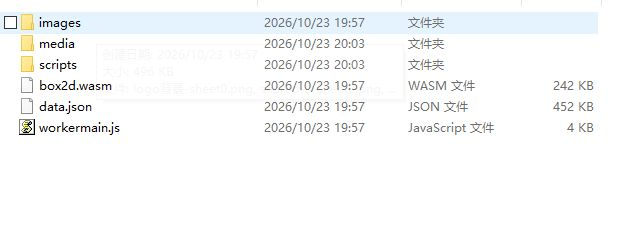
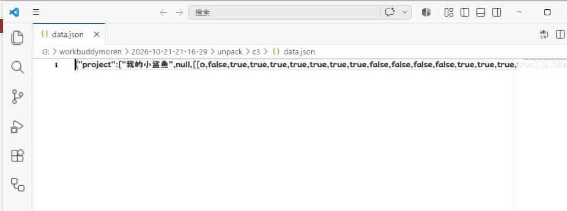
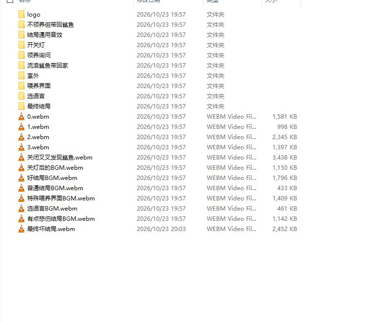
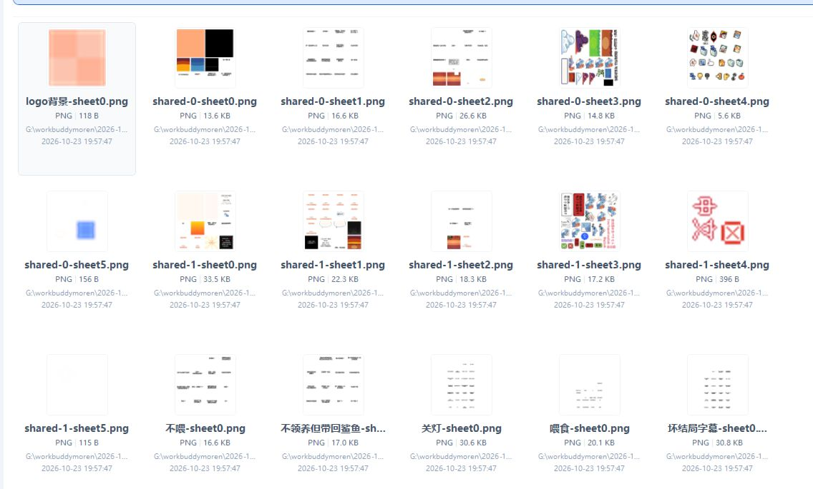

# 我破解了我的小鲨鱼

> 分类：教程 · 2026-10-23 · 标签：破解 / 解包 / Construct 3 / 我的小鲨鱼

《我的小鲨鱼》是 Steam 上一款小品级的国产恐怖养成游戏。表面上你养一条方块小鲨鱼，喂食、锻炼、开灯关灯，多周目下来才会发现它讲的是完全另一个故事。游戏用 Construct 3 制作，发行版是一个 36 MB 的 Tauri 打包 exe。

这篇文章记录我把这个 exe 整个剥开的过程。不是提取几个图片音效就收工，而是把里面的 Construct 3 工程文件<strong>完整还原</strong>了出来：20 个布局、20 张事件表、158 个对象类型、128 个配音与 BGM、29 张精灵图，一个不少。

<h2 id="_1">成果：整个 C3 工程被剥了出来</h2>

解包得到的单文件 HTML 可以直接双击运行，游戏完整可玩。本地原版文件加了一个开幕提示，明示这是解包版本、不要分发：

图 1：解包产物的工程目录，images / media / scripts / box2d.wasm / data.json 一应俱全

<h2 id="_2">解包原理：三层套娃</h2>

这个 exe 是典型的「套娃」结构，从外到内三层，每层用的都是官方标准格式，所以剥起来反而干净利落。

<h3>第一层：Tauri 外壳</h3>

exe 本体是 Rust 编译的 PE 文件，运行时是 <strong>Tauri 1.5.4</strong>（Rust + 系统 WebView2）。判断依据很直接：.rdata 里能翻出 <code data-plain="tauri-1.5.4/src/manager.rs">编译路径字符串</code> 和 <code data-plain="__TAURI_IIFE__">前端注入的 API 桥</code>。前端资源在 Tauri 里以 asset 形式嵌进二进制，用 phf 静态 Map 管理。

<h3>第二层：brotli 压缩的 index.html</h3>

.rdata 中段有一块 30 MB 的高熵数据（0x34C000–0x2138000），这是整块压缩后的前端。定位方法是在其末尾找 phf 资源表，里面只有一条记录：

<pre><code>"/index.html" -&gt; ptr=0x14034D49B, len=0x1DEC2B9</code></pre>

也就是偏移 0x34C49B 起、长 31,376,057 字节的一段 brotli 流。Tauri 的 <code data-plain="EmbeddedAssets::get()">资源读取函数</code> 本身就是用 brotli 解压的，照方抓药即可：解出来是一个 44.8 MB 的完整 index.html。

<h3>第三层：c3_base64files</h3>

这个 HTML 是 Construct 3 的「单文件导出」格式，内部结构是：

<pre><code>self.c3_base64files = {
  "scripts/c3runtime.js": { "type": "application/javascript", "str": "..." },
  "data.json":            { "type": "application/json",      "str": "..." },
  "box2d.wasm":           "data:application/wasm;base64,AGFyZ...",
  "images/xx-sheet0.png": "data:image/png;base64,iVBORw0KG...",
  ...
}</code></pre>

脚本文件是明文 JS 字符串，二进制素材是 base64 data URI。用 Node 把这个对象 eval 出来再逐条落地，165 个工程文件全部还原，PNG / WebM / WASM 均通过文件头校验，无一损坏。

图 4：剥离出的 data.json，Construct 3 的数组化工程数据，开头就是项目名「我的小鲨鱼」

<h2 id="_3">工程里都有什么</h2>

data.json 是 Construct 3 新版的数组化压缩格式，按索引可以读出完整工程信息：

<table><thead><tr><th>内容</th><th>数量</th><th>说明</th></tr></thead><tbody><tr><td>布局 Layout</td><td>20</td><td>温馨提示 → 开场 LOGO → 选语言 → 常规喂养 / 外出 → 结局 1–11 → 好 / 坏结局 → 领养询问</td></tr><tr><td>事件表 Event sheet</td><td>20</td><td>每个布局对应一张，全部逻辑都在里面</td></tr><tr><td>对象类型 Object type</td><td>158</td><td>小鲨鱼、苹果、锻炼、关灯、垃圾桶、各结局图文…</td></tr><tr><td>音频（webm/opus）</td><td>128</td><td>全语音 + BGM，约 39 MB</td></tr><tr><td>图片（PNG）</td><td>29</td><td>精灵图与图块</td></tr><tr><td>WASM</td><td>2</td><td>box2d 物理、opus 音频解码</td></tr></tbody></table>

图 2：media 目录按场景分文件夹，连每句配音的音效文件名都原样保留

图 3：images 目录，29 张 PNG 精灵图

<h2 id="_4">配音示例</h2>

这游戏最有感染力的是配音。下面几条直接从剥出的 webm 里挑的（网页播放器可直接放）：

<video controls preload="metadata" style="width:100%;max-width:560px;border-radius:12px;display:block;margin:0 auto 8px;"><source src="media/01-stray-shark.webm" type="audio/webm"></video>

流浪鲨鱼带回家：「呼……这一次终于不用再被变成电子程序了。」

<video controls preload="metadata" style="width:100%;max-width:560px;border-radius:12px;display:block;margin:0 auto 8px;"><source src="media/02-afraid-dark.webm" type="audio/webm"></video>

开关灯：「我害怕关灯……」

<video controls preload="metadata" style="width:100%;max-width:560px;border-radius:12px;display:block;margin:0 auto 8px;"><source src="media/03-stop-clicking.webm" type="audio/webm"></video>

选语言：「不要再点我啦。」

<video controls preload="metadata" style="width:100%;max-width:560px;border-radius:12px;display:block;margin:0 auto 8px;"><source src="media/07-prefer-chinese.webm" type="audio/webm"></video>

选语言：「我觉得要不选中文吧？」

<video controls preload="metadata" style="width:100%;max-width:560px;border-radius:12px;display:block;margin:0 auto 8px;"><source src="media/04-japanese.webm" type="audio/webm"></video>

选语言：「选了日语。」

<video controls preload="metadata" style="width:100%;max-width:560px;border-radius:12px;display:block;margin:0 auto 8px;"><source src="media/05-english.webm" type="audio/webm"></video>

选语言：「选了英语。」

<video controls preload="metadata" style="width:100%;max-width:560px;border-radius:12px;display:block;margin:0 auto 8px;"><source src="media/06-chinese.webm" type="audio/webm"></video>

选语言：「选了中文。」

<video controls preload="metadata" style="width:100%;max-width:560px;border-radius:12px;display:block;margin:0 auto 8px;"><source src="media/08-shark-clicked.webm" type="audio/webm"></video>

选语言：小鲨鱼被点击时的叫声

<h2 id="_5">一点声明</h2>

==本文与解包产物仅供个人学习研究使用。游戏素材版权归原作者所有，转载请不要分发这个版本，更不要拿去商用；如有不妥请联系我，我会第一时间删除。==

顺带一句：Construct 3 工程一旦导出成单文件 HTML，加密和防扒基本就等于没有——这不是作者的问题，是引擎定位使然。真正想保护资产，得在打包和分发层想办法。

            
            
