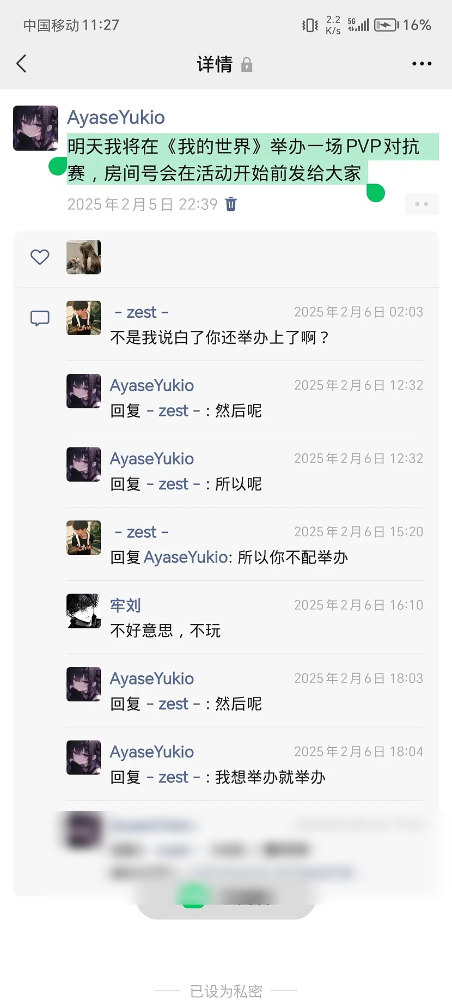
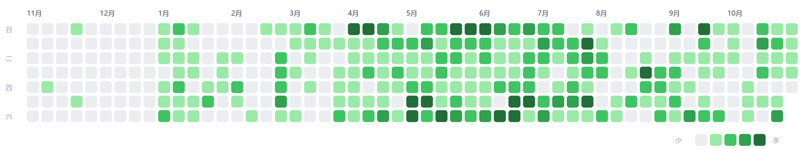
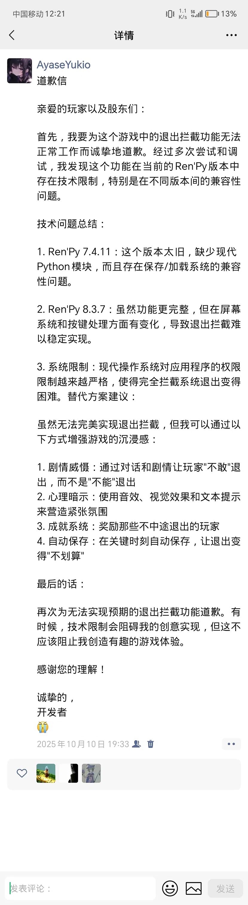

# 热力图会变白

==
**免责声明：**
这是一份个人记录，不是控诉书，也不是劝谁的话。文中出现的同学、老师一律用字母代替；涉及任何具体做法的地方我一律不写——不是怕，是不想给后来的人抄作业。如果你正在经历类似的事，文末有号码，是真的能打通的那种。==

## 前言：为什么是今天

今天是 2026 年 10 月 29 日。

六天前是 10 月 23 日。

我把这两天之间的距离叫做「缓过来」，不叫「好了」。这两个词差得很远，混用会出事。

至于为什么现在写——因为再往后拖，我大概会开始给自己改稿。人会不自觉地美化自己扛过的东西，把当时的狼狈改写成「那时候我就知道」。趁我还记得清楚，先存档。

这篇里没有反转，也没有「感谢伤害我的人让我成长」。那些话我说不出口，也不想说。

## 一、时间线

我按顺序排一遍。排完你会发现一件事：**这场戏不是从同学开始的。**

**2022—2023。** 状态已经不对了。那时候我自己没意识到，只是觉得每天都累，累得没有理由。

**2024 年 5 月。** 姥爷走了——22、23 年最疼我的那个。

葬礼那天我没哭。

我很平静地站在那儿，看见大人们哭得东倒西歪，我甚至有点想笑。

很久以后我才知道那不是冷血，是**极度的伤心根本发不出来**。

**这条线是从这里开始的。** 不是从任何一个同学，也不是从六年级。

**2024 年 6、7 月。** 在 B 站关注了 Warma。她让我度过了那一年。这句话我写得很平，但它是真的，不是客套。

**2024 年 9 月 28 日。** 人生第一次坐飞机，去新疆。

那天我是真的很激动。不掺水的、纯粹的、小孩子的激动。那是那一年里唯一一件让我觉得「活着还挺好的」的事。

**2025 年春天。** 两件事，挤在两个月里。

第一件：我在朋友圈发了一条《我的世界》PVP 对抗赛的公告，房间号说活动前发。有个同学 D 在下面评论——

> 不是我说白了你还举办上了啊？所以你不配举办。

第二件：另一条线，牵扯到三个人，从「我最近想学习，先不跟你说话」开始，一路走到体育课上因为排队吵翻。

那阵子我还查过一些不该查的东西，画过图，最后什么都没做。

**紧接着。** 老师知道了。她没有先问我。

她站在全班面前把这件事讲了一遍。然后骂我，骂我妈，骂到我去世的姥爷。

我在心里把念头从「一个人」扩大到「一整班」，就是在这之后。

**2025 年 6 月。** 毕业前。有过一次没完成的尝试。

**2025 年全年。** 一串「人生第一次」，后面单开一节讲。

**2026 年 10 月 23 日。** 又一次。这次和同学没关系。

**2026 年 10 月 29 日。** 我在写这个。

## 二、一个人的 PVP

那条朋友圈的原文我到现在还记得，一个字都没改：

> 明天我将在《我的世界》举办一场 PVP 对抗赛，房间号会在活动开始前发给大家

我把它贴出来，是因为我想让所有看到这篇文章的人自己读一遍，然后回答我一个问题：

**这句话，到底哪里值得被骂？**

一条邀请别人来玩的公告，我到现在也没想明白它哪里有问题。

那句「你不配举办」的结构，我后来拆过很多遍：

前半句是惊讶（「你还举办上了」），后半句直接跳到判决（「不配」）。中间那一段——也就是「为什么」——是空的。

因为本来就没有。

说这句话的人，不是老师，不是主办方，不是任何有权限说「这个活动准不准办」的角色。他手里没有任何可以否决我的东西。

我当时没想通，后来才反应过来：他大概不是觉得我不配，是他自己不来，又不好说。

「不配」这两个字，说的是他自己，不是我。

**但这句话真正砸到的地方，跟 PVP 一点关系都没有。**

那段时间我给自己在 MC 里划了一小块地。规则我定，房间号我发，来几个人算几个人，那个地方不需要任何人批准——**这就是它全部的意义**。一个刚失去姥爷、家里接不住、学校里没有任何一个成年人站在我这边的人，在游戏里给自己搭了个屋顶。

然后有个人跑过来，指着这块地说：这地方不该有。

他以为自己只是在嘲讽一条朋友圈。

他砸的是屋檐。

后来我自己也说过一句话，比任何心理学的解释都准：**如果不做这个，那个患者就直接 cos Sayori 了。**

（DDLC 的梗。懂的都懂，不懂的别去查，那游戏对现在的心情不友好。）

## 三、我算过一笔账

有一阵我经常想一件事：如果那时候真的成了，会怎么样。

想得很具体，具体到有点好笑。我列一遍给你们看：

- 我那个 GitHub 主页，热力图会从一片绿，慢慢变白。
- 那 16 个关注我的人，某天点进来，看到「67 天前更新」。
- 我的站还在线，但不会再更新。MoeFace 停在最后一次 commit，变成 archived。
- 营销号会发现我。标题大概是「小学六年级天才程序员离世」。
- 他们会给我编一堆头衔：网安黑客、gal 写作大神、独立开发者。
- 评论区会有一句「晚安，愿天堂也有 XX」。
- 然后一群没开智的小学生跑去别人网安视频底下刷「不如那个谁」。
- 最后我遗臭万年。

我列到一半就笑出来了。

因为这里面有一个根本性的错误：

**营销号不会来。**

他们只写有流量的东西。一个 13 岁的死在他们那儿值两天的阅读量，第三天就被下一个热点顶掉，之后二十年没人再提。

真实情况是这样：

- 热力图从绿色变白色。
- 仓库变成 inactive。
- 站还在，但不再更新。
- 一年之后，除了我妈和几个同学，没人再打开过。

没有什么传说，就是一片白。

我幻想的那份「被记住」，比现实仁慈太多了。

所以我后来跟人说起这段，最后一句总是同一个：

**「我真庆幸我没死。」**

这句话不是别人劝出来的，是我自己顺着上面那笔账算出来的。一圈排下来，我发现死了以后的世界比活着更荒唐。

这个算法我记住了。以后再滑到那个念头上的时候，不从情绪那头想，从这头算：

**热力图会变白。**

## 四、这几个月我到底在干什么

如果只看病历，这一段应该是「恶化」。但实际发生的事，跟那个词完全不搭。

我列一下，都是真的：

- 给一个 Ren'Py 游戏写了封道歉信。因为我想做一个「玩家无法退出」的功能，做不出来。信里有完整的技术归因（7.4.11 缺现代 Python 模块、8.3.7 的屏幕与按键处理变了），还有四条替代方案。落款是「诚挚的，开发者」。
- 和 AI 一起搞了一套系统，有 iso 镜像。
- 人生中第一次电脑中毒。文件全毁。
- 人生中第一次买游戏。
- 人生中第一次飞无人机，DJI Mini 3，飞了 1 公里。
- 在 Kali 里跑通了 exe。
- 人生中第一次键政，被人骂「台独分子」。
- 人生中第一次通关一个游戏，完美通关，21.7 小时。
- 人生中第一次做 MMD，做了 5 个小时。
- 人生中第一次做 Unity 游戏。
- 人生中第一次被一个脚本的 28 个报错和一个 18170.4 元的许可证教育。

那年我 12 岁。

现在回看，那一整年不是在玩。**那是在废墟上给自己重新搭骨架。**

一根一根搭，搭到能站住为止。

那封道歉信我现在还留着。它比任何营销号能编出来的「天才故事」都更像我——一个小孩，对着不存在的股东，用公函体道歉，因为他做不出一个阴间功能。

那才是真的。

## 五、我不打算成为传说

写到这里，我大概知道这篇文章会被怎么读。

有人会觉得我在卖惨。有人会觉得我在炫耀。有人会截图发出去配一句「现在的初中生」。

都行。

我写它，只有三个目的：

**一，存档。** 上面那条时间线，是我第一次完整排出来。排完之后我自己看清楚了一件事：起因不是某个同学，是 2024 年 5 月那场葬礼。同学、老师、那些话，全都是砸在一个还没长好的地方。

**二，把「配不配」这件事结掉。** 一个人的 PVP 不需要任何人批准。它不需要报名人数，不需要理由，不需要谁点头。它只需要「我想办」。

那句「你不配」已经过期一年半了。地还在。

**三，给那 16 个人一个交代。** 你们关注的那个号，中间断过。断的时候我没在写代码，我在算一笔账。现在算完了，结论是继续 push。

---

最后说一件事。

我这一阵发现，「我死了会怎么样」这个念头，最容易在**缓过来之后**回来。危机的时候人只想结束，缓过来以后才有余力想后续，而想的往往就是「有没有人记得我」。

如果你的脑子里也在放这段，我把它拆给你看：

你想要的不是死。你想要的**是让这个故事由你来定稿**。

这两件事被捆在一起了，但它们不是一件事。传说是别人拿你的死编的，作者不是你，你连改一稿的资格都没有。

而你现在就能自己写，署自己的名，还能发第二版。

**不用死，才能拥有作者的署名权。**

---

*写于 2026 年 10 月 29 日，缓过来第六天。*
